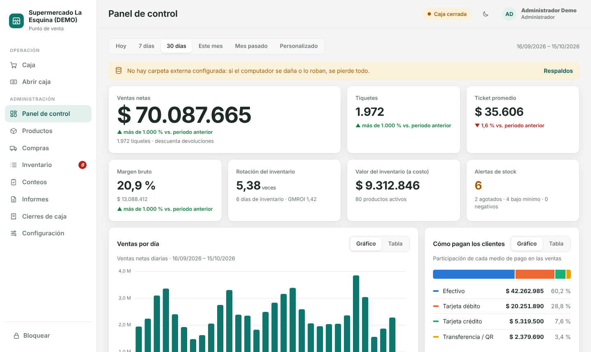
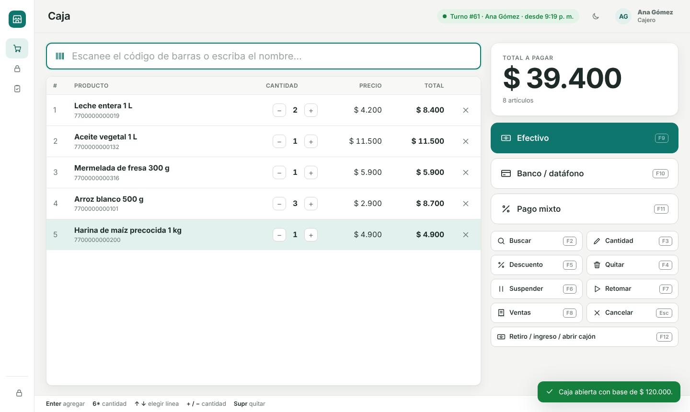
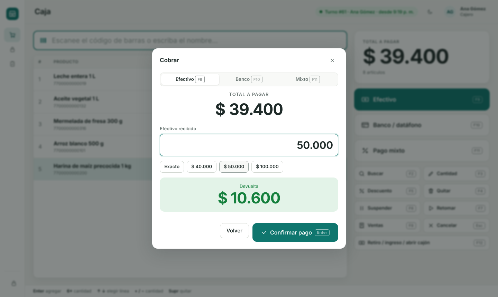
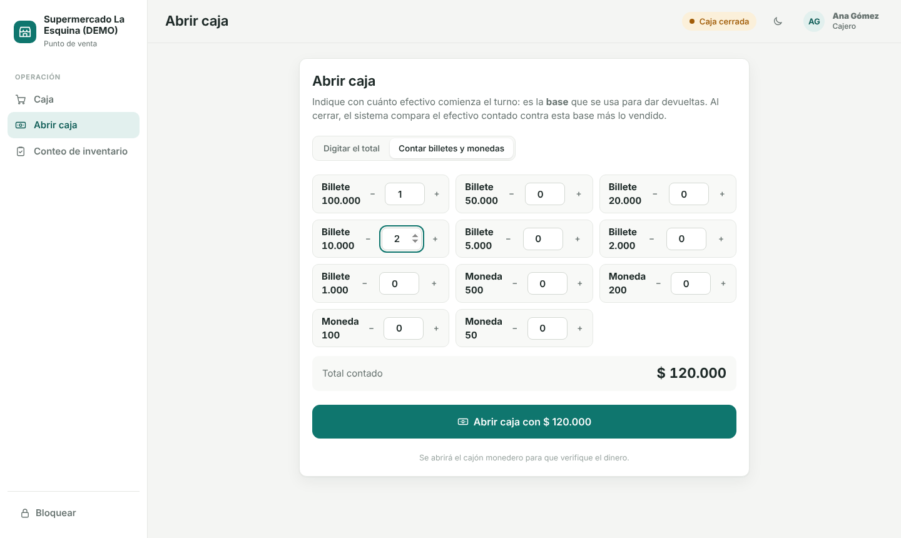
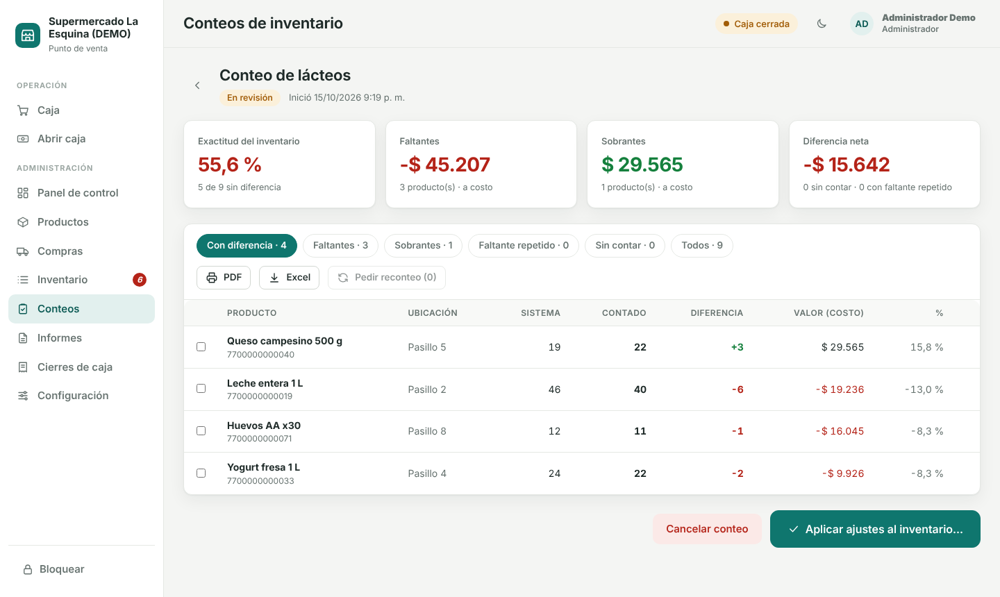
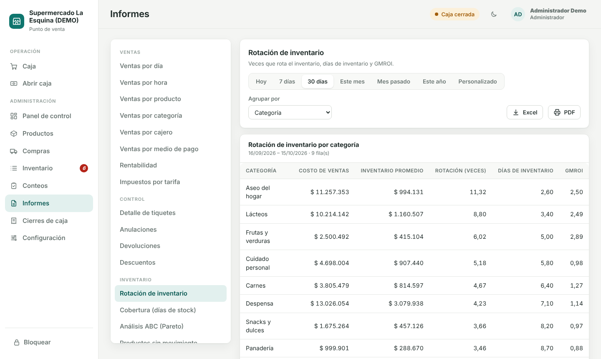
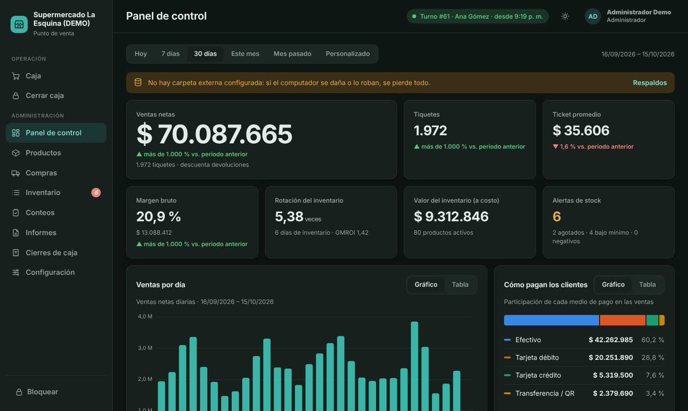

# POS Supermercado

Sistema de punto de venta para un supermercado que **funciona en un solo computador y guarda toda la
información en él** (no depende de internet). Interfaz moderna y descansada, pensada para usarse casi
todo con teclado y lector de código de barras.



## Qué incluye

| Área | Qué hace |
|---|---|
| **Caja** | Venta con lector de código de barras siempre enfocado · cantidad con `6*` · pago en **efectivo** (con devuelta), **banco** (débito, crédito, transferencia/QR) o **mixto** · ventas suspendidas · descuentos · anulaciones y devoluciones con PIN del administrador · cajón monedero · recibo en PDF. |
| **Turnos** | Al abrir caja pregunta la **base** (el efectivo con el que se da devueltas; se puede contar por billetes y monedas). Al cerrar hace un **arqueo ciego**: el cajero cuenta sin ver cuánto debería haber; el sistema calcula sobrante/faltante en efectivo y en banco. Retiros e ingresos con motivo y autorización. |
| **Inventario** | Productos con varios códigos de barras (y códigos de paca), kardex de cada movimiento, compras con **costo promedio ponderado**, mermas, ajustes, alertas de stock, importación desde Excel y cambio masivo de precios. |
| **Conteos** | El administrador decide **cuándo** contar (manual o programado: cada N días, semanal, quincenal, mensual) y qué (todo, una parte, o cíclico). Captura **ciega** con el lector, se puede contar con la tienda abierta (el stock teórico es el del momento exacto de cada captura), revisión de **inconsistencias** (faltantes/sobrantes en pesos, faltantes repetidos en conteos seguidos, exactitud), reconteo y aplicación de ajustes. |
| **Panel e informes** | Ventas, margen, ticket promedio, **rotación de inventario**, días de inventario, GMROI, análisis ABC, mapa de calor de horas, productos sin movimiento, sugerido de compras, mermas, IVA por tarifa, diferencias de caja por cajero… 22 informes con exportación a Excel y PDF. |
| **Seguridad** | Roles (administrador / cajero), PIN para acciones sensibles, auditoría de lo importante, bloqueo de pantalla, bloqueo tras intentos fallidos, respaldos automáticos con copia externa. |

## Capturas

| Caja: escaneo, carrito y atajos | Cobro en efectivo con devuelta |
|---|---|
|  |  |

| Abrir caja con la base | Revisión de inconsistencias de un conteo |
|---|---|
|  |  |

| Rotación de inventario (informes) | Panel de control en tema oscuro |
|---|---|
|  |  |

## Cómo empezar

### Con datos de demostración (para conocerlo)

Requiere **Python 3.11 o superior**.

```bash
# Windows: doble clic en iniciar.bat           Linux/macOS: ./iniciar.sh
# (la primera vez crea el entorno e instala lo necesario)
```

Para ver el panel con historia real, cargue la demostración **antes** del primer uso (borra datos existentes con `--forzar`):

```bash
cd backend
python -m app.seed_demo --dias 30 --ventas-dia 90 --forzar
# usuarios: admin / demo1234 (PIN 1234) · ana / ana1234 (PIN 4321) · luis / luis1234 (PIN 4321)
```

### En la tienda

1. Instale (instalador de Windows, ver *Empaquetado*) o ejecute `iniciar.bat`.
2. La **primera vez** el sistema pide los datos del negocio y crea al administrador (usuario, contraseña y PIN). No hay contraseñas por defecto.
3. Cargue los productos: **Productos → Importar Excel** (hay plantilla), o créelos uno a uno.
4. Haga un **conteo total inicial** (Conteos → Nuevo conteo → Todo el inventario): ese es el stock de arranque.
5. Cree los usuarios de los cajeros (Configuración → Usuarios) y configure el **cajón** y la **carpeta de respaldos externa**.

## Uso diario

**Cajero:** inicia sesión → *Abrir caja* (base) → vende → *Cerrar caja* (cuenta el efectivo).

| Tecla | Acción | | Tecla | Acción |
|---|---|---|---|---|
| `Enter` | agregar lo escaneado | | `F6` / `F7` | suspender / retomar venta |
| `6*` + escanear | 6 unidades | | `F8` | ventas del turno (recibo, anular, devolución) |
| `F2` | buscar por nombre | | `F9` `F10` `F11` | cobrar: efectivo / banco / mixto |
| `F3` | cambiar cantidad | | `F12` | retiro, ingreso o abrir cajón |
| `F4` / `Supr` | quitar línea | | `Esc` | cancelar venta |
| `F5` | descuento | | `↑` `↓` `+` `-` | elegir línea / cantidad |

## Datos, respaldos y recuperación

* Base de datos: un archivo SQLite en `C:\ProgramData\POSSupermercado\data\pos.db` (Windows) o `~/.local/share/pos-supermercado/data/` (Linux). Variable `POS_DATA_DIR` para cambiarla.
* **Respaldo automático** diario (a la hora configurada; si el equipo estaba apagado, al encenderlo) y al cerrar cada turno. Se hace con la API de *backup* de SQLite: es consistente aunque se esté vendiendo y **no bloquea las ventas**.
* **Copia externa**: configure una carpeta en un USB, disco externo o carpeta sincronizada (Google Drive para escritorio, OneDrive, Dropbox). El panel avisa si el último respaldo externo es viejo.
* Restaurar: *Configuración → Respaldos → Restaurar* (pide contraseña; antes guarda una copia de lo actual).
* Un corte de luz no deja ventas a medias: cada venta es una transacción atómica (SQLite en modo WAL con `synchronous=FULL`). Se recomienda un **UPS**.

## Hardware

* **Lector de código de barras**: cualquier USB tipo teclado (no necesita drivers).
* **Cajón monedero**: Configuración → *Cajón monedero*. Tres formas de conexión: puerto serie/USB propio, a través de una impresora térmica instalada en Windows (cable RJ11), o dispositivo de archivo. Sin cajón configurado, todo funciona igual.
  Se abre al cobrar en efectivo, al abrir caja y en retiros. *Pendiente de probar con hardware real* (ver abajo).
* **Impresora**: por ahora el recibo es un PDF de 80 mm para ver/imprimir. La impresión directa en térmica (ESC/POS) es una mejora futura.

## Facturación electrónica (DIAN)

Todavía no está implementada: hoy se entrega un tiquete interno. El diseño ya está preparado (consecutivo configurable, datos del cliente, impuestos desglosados por línea, campos `estado_dian`/`cude`, interfaz `ProveedorDIAN` en `backend/app/fiscal/`). **Confirme con su contador si el negocio ya está obligado a emitir el documento equivalente electrónico POS**; si lo está, esta es la siguiente fase.

## Desarrollo

```
backend/app/          FastAPI: models, services (reglas de negocio), routers (API), jobs, hardware, fiscal
backend/tests/        pruebas (reglas de negocio, robustez, interfaz en navegador real, volumen)
frontend/             Vue 3 sin paso de compilación; librerías incluidas (funciona sin internet)
installer/            PyInstaller (.spec) e Inno Setup (.iss)
launcher.py           arranca el servidor local + la ventana de escritorio (pywebview)
docs/                 plan original y arquitectura
```

```bash
cd backend
python -m venv .venv && .venv/bin/pip install -r requirements-dev.txt   # Windows: .venv\Scripts\...
python -m pytest -q                       # 60+ pruebas; las de interfaz usan Chromium (python -m playwright install chromium)
python tests/perf_volumen.py              # 30.000 productos y un año de ventas (~1 millón de líneas)
python -m uvicorn app.main:app --reload   # API + interfaz en http://127.0.0.1:8765  (docs de la API: /api/docs)
```

### Rendimiento medido

Con 30.000 productos y 943.000 líneas de venta (un año a 300 ventas diarias):

| Operación | Tiempo | Objetivo |
|---|---:|---:|
| Escanear un código de barras | 6 ms | < 100 ms |
| Buscar un producto por nombre (F2) | 55 ms | < 300 ms |
| Cobrar una venta de 10 productos | 45 ms | < 300 ms |
| Panel de control, 30 días / 1 año | 0,4 s / 1,5 s | < 2 s / < 3 s |
| Informes anuales (ventas, rentabilidad, ABC, IVA, sin movimiento…) | 0,1 – 1,3 s | < 2 s |
| Rotación de inventario (30 días) | 0,9 s (la 1.ª vez 4,7 s: crea las fotos diarias) | < 2 s |
| Iniciar / cerrar captura / revisar un conteo de 30.000 productos | 0,04 s / 1,5 s / 0,9 s | < 5 s |
| Exportar a Excel las ventas por producto del año | 1,8 s | < 5 s |
| Respaldo manual de una base de 250 MB (no bloquea las ventas) | 11 s | < 20 s |

### Empaquetado (Windows)

`scripts\build_windows.bat` genera `dist\POSSupermercado\` con PyInstaller y, si tiene Inno Setup 6, el instalador `.exe`.
La ventana usa Microsoft Edge WebView2 (incluido en Windows 10/11 actualizados).
> **Estado:** el empaquetado se verificó construyendo y arrancando el ejecutable en Linux; los scripts de **Windows** (`.bat`, `.iss`) y la ventana nativa **no se han probado en Windows**.

## Seguridad

El servidor solo escucha en `127.0.0.1` y rechaza peticiones cuyo `Host` no sea local. Contraseñas y PIN con Argon2; sesiones por token; bloqueo temporal tras 5 intentos fallidos; precios y totales siempre se recalculan en el servidor; el cajero no recibe costos ni márgenes; las ventas nunca se borran (se anulan) y las acciones sensibles quedan en la auditoría con quién las autorizó.

## Limitaciones conocidas

No incluye (aún): productos por peso/balanza, impresión directa en térmica, facturación DIAN, varias cajas en red, crédito (fiado), lotes y vencimientos, promociones, clientes en la pantalla de venta (la API ya los soporta). Ver `docs/plan.md` (fase 7).
